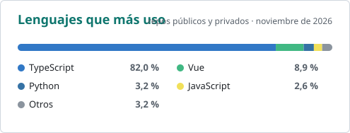

  

  

  
  

  
  
  

---

## 👨‍💻 Sobre mí

Soy **desarrollador full stack** en Tarragona. Desde **noviembre de 2024** diseño, desarrollo y mantengo
aplicaciones **en producción, de principio a fin**: hablo con quien las va a usar, decido la arquitectura,
las construyo, las despliego y me encargo de que sigan funcionando.

Trabajo con **IA + arquitectura de código y buenos principios**. Desarrollo con agentes de IA
(Claude Code, MCP), pero la arquitectura, la revisión y el mantenimiento son cosa mía.

Antes pasé **seis años llevando equipos en hostelería** (de 6 a 10 y de 21 a 50 personas). Eso me ayuda
a entender el negocio y a hablar con cada departamento antes de proponer una solución técnica.

- 🔭 Ahora mismo: la plataforma de gestión de obra de una empresa de instalación de ventanas y **Aura Planing**.
- 💬 Pregúntame por: apps **offline-first**, sincronización, **IA dentro del producto** y automatizaciones.
- 🌍 Hablo español (nativo), inglés (intermedio) y catalán (básico).

## 🎯 Qué busco

| | |
|:--|:--|
| 💼 **Puesto** | Desarrollador Full Stack o Backend · Automatización con IA · Responsable IT de pyme |
| 📍 **Dónde** | Tarragona o Barcelona (presencial o híbrido) · Remoto |
| ✨ **Me motiva** | Producto propio, IA aplicada de verdad y procesos que se pueden automatizar |
| 🛂 **Datos** | Permiso de trabajo UE · Carné B y vehículo propio |

---

## 🛠️ Stack

| | |
|:--|:--|
| ⚙️ **Backend** |     |
| 🎨 **Frontend** |    |
| 🗄️ **Datos** |  |
| ☁️ **Infraestructura** |  AWS App Runner, S3 y Lambda · Cloudflare Tunnel |
| 🤖 **IA y automatización** |       |
| 🧭 **Forma de trabajo** |     |

---

## 🚀 Proyectos destacados

### 🪟 Plataforma de gestión de obra · *proyecto principal*

> Digitalización de una empresa de instalación de ventanas, como **consultor técnico y responsable IT**.
> Sustituí procesos manuales por una plataforma propia que usan cada día la oficina, los técnicos en obra
> y la dirección. 🔒 Código privado.

- 📱 **App web y Android** (React + Capacitor) **offline-first**: los técnicos registran en obra sin
  cobertura (IndexedDB y service workers) y todo se sincroniza al volver la red.
- ⚙️ **Backend** en Node.js/Express, PostgreSQL con Prisma y tiempo real con Socket.io.
- 🤖 **IA en producto** con la API de Anthropic: lectura automática de PDF de pedidos y presupuestos, y un
  asistente de consulta sobre los datos sin permisos de escritura.
- 🗂️ **Operativa**: mediciones, montaje, fichajes en tablet compartida con PIN, planificación de equipos,
  incidencias con aviso al proveedor y panel de métricas para dirección.
- ☁️ **Infraestructura**: AWS (App Runner, S3, Lambda), copias de seguridad diarias, alertas a Telegram,
  CI/CD con GitHub Actions y auditorías de seguridad.

  
  
  
  
  
  
  

<table>
  <tr>
    <td width="50%" valign="top">
      <h3>🗓️ Aura Planing</h3>
      
Planificación de turnos y gestión de personal para retail.

      
<a href="https://aura-planing.es">🔗 aura-planing.es</a>

      
NestJS · Vue · PostgreSQL/Prisma · Redis/BullMQ · IA con Anthropic · Supabase · servidor propio

    </td>
    <td width="50%" valign="top">
      <h3>☕ StoreFlow</h3>
      
SaaS B2B para cadenas de cafeterías. En producción y en desarrollo activo.

      
Next.js · Firebase · Gemini

    </td>
  </tr>
  <tr>
    <td width="50%" valign="top">
      <h3>⚡ Automatizaciones</h3>
      
Flujos con n8n, bots de Telegram, un organizador de correo con IA y un asistente con modelo local.

      
n8n · Telegram · Ollama · webhooks

    </td>
    <td width="50%" valign="top">
      <h3>🐾 PetRadar</h3>
      
App móvil en la que soy <b>tech lead de un equipo de 3</b>.

      
Expo · React Native

    </td>
  </tr>
  <tr>
    <td colspan="2" valign="top">
      <h3>🖥️ Laboratorio propio</h3>
      
Dos servidores Linux con Docker, Coolify, Cloudflare Tunnel y Cloudflare Access, monitorización con
      Uptime Kuma, Ollama con GPU y un panel propio para gestionarlos (Server Hub).

    </td>
  </tr>
</table>

---

## 🧠 Cómo trabajo

- 🧩 **Primero el proceso, luego el código**: hablo con oficina, técnicos y dirección antes de proponer nada.
- 🏗️ **La IA acelera, yo decido**: uso agentes de IA para ir rápido, pero la arquitectura y la revisión son mías.
- 🧪 **Calidad**: tests E2E con Playwright y documentación de arquitectura.
- 🔐 **Seguridad y operación**: auditorías de seguridad, copias diarias, monitorización y alertas.
- 🚢 **De principio a fin**: del primer boceto a producción, y después el mantenimiento.

---

## 📊 Actividad en GitHub

> 🔒 Casi todo mi código vive en repositorios privados; estas gráficas cuentan también esa actividad.

  <picture>
    <source media="(prefers-color-scheme: dark)" srcset="https://github-readme-activity-graph.vercel.app/graph?username=bfktrick&bg_color=0d1117&color=c9d1d9&line=14b8a6&point=f59e0b&area=true&area_color=14b8a6&title_color=14b8a6&hide_border=true&custom_title=Contribuciones%20de%20los%20%C3%BAltimos%2031%20d%C3%ADas" />
    
  </picture>

  <picture>
    <source media="(prefers-color-scheme: dark)" srcset="https://streak-stats.demolab.com?user=bfktrick&locale=es&hide_border=true&background=0D1117&ring=14B8A6&fire=F59E0B&currStreakNum=14B8A6&currStreakLabel=14B8A6&sideNums=C9D1D9&sideLabels=8B949E&dates=8B949E&stroke=30363D" />
    
  </picture>
  <picture>
    <source media="(prefers-color-scheme: dark)" srcset="assets/lenguajes-dark.svg" />
    
  </picture>

  <picture>
    <source media="(prefers-color-scheme: dark)" srcset="https://raw.githubusercontent.com/bfktrick/bfktrick/output/serpiente-dark.svg" />
    
  </picture>

---

## 🎓 Formación

- 🎓 Estudios universitarios de **Desarrollo de Software** · Universidad del Valle (Colombia)
- 🤖 **Desarrollo con IA: de 0 a producción** · BIG school (2026)
- ⚡ **IA, vibe coding y automatizaciones** · BIG school (2026)

🇬🇧 <b>English summary</b>

 

**Full stack developer** based in Tarragona, Spain. Since November 2024 I have been designing, building and
running **production apps end to end**: offline-first web and Android apps (React, Capacitor), Node.js/NestJS
backends with PostgreSQL and Prisma, Vue and Next.js frontends, AI features built on the Anthropic API, and AWS / Docker infrastructure
with CI/CD on GitHub Actions. I build with AI agents (Claude Code, MCP), while architecture, review and
maintenance stay with me. Before that, six years leading teams in hospitality.

Looking for **full stack / backend developer**, **AI automation** or **IT lead** roles in Tarragona or Barcelona,
or remote. Spanish (native), English (intermediate), Catalan (basic). EU work permit.

---

## 📫 Contacto

¿Tienes un puesto o un proyecto en el que encaje? Escríbeme y lo hablamos.

  
  
  

  

